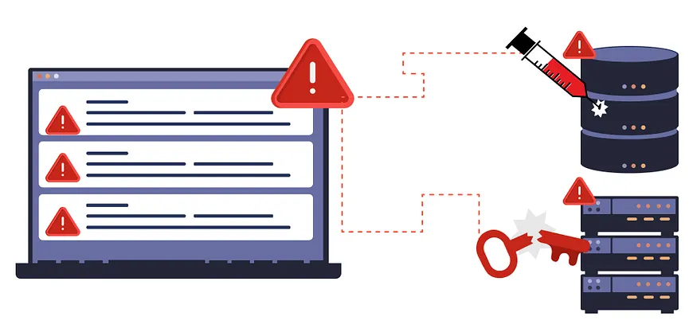
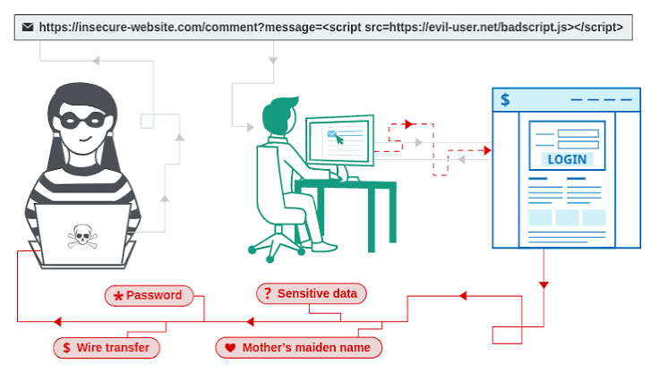
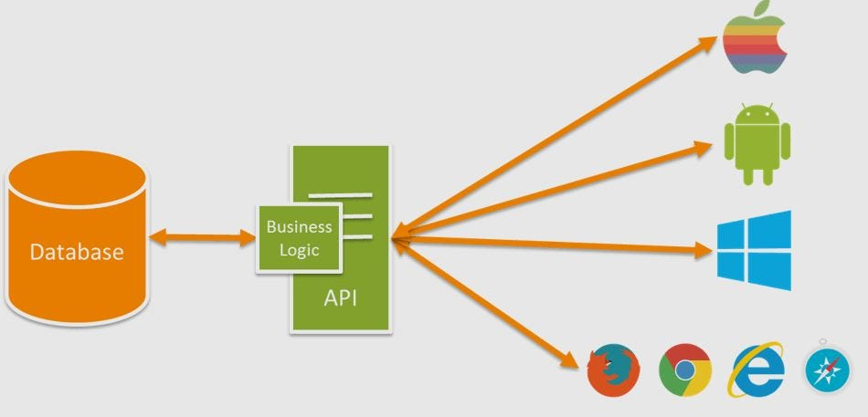
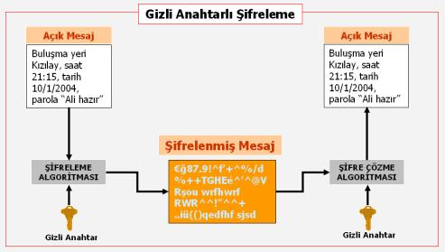
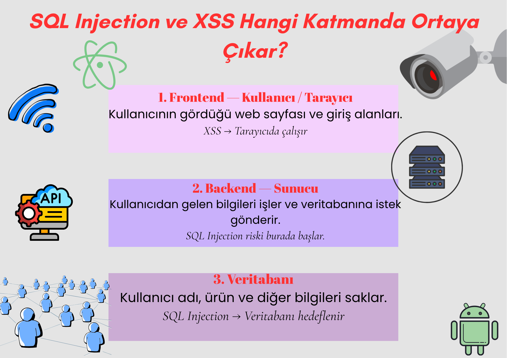

*4. Hafta --Webin Devamı, Güvenlik ve Büyük Resim*

TARİH:27 Ekim Salı-

**KONU:** *Bir uygulamayı güvenli yapmak neden ayrı bir konu?*

**##Araştırma Soruları**
1)Kullanıcı şifresi neden düz metin olarak saklanmamalıdır?
2Hash nedir?Encrypt ile aynı şey midir?
3)Input validation neden yapılır?
4)SQL Injection nedir?
5)XSS nedir?
6)API key,parola veya bağlantı bilgileri neden repository'ye yazılmamalıdır?
7)Secret kavramı neyi ifade eder?

**##Günün Sonunda Teslim Edilecekler**
1)Bir kullanıcı kayıt sistemi tasarlarken dikkat edeceğiniz güvenlik maddelerini listeleyin.
2)Repository’ye kesinlikle koymamanız gereken bilgilere örnekler bulun.
3)SQL Injection ve XSS’in hangi katmanda ortaya çıktığını kendi şemanız üzerinde göstermeye çalışın.

---------

**1.SORU:Kullanıcı şifresi neden düz metin olarak saklanmamalıdır?**

*Parolaların düz metin olarak saklanması web uygulamalarında ciddi güvenlik riskleri oluşturur.Bu risklerden biri ,yetkisiz erişime karşı artan güvenlik açığıdır.

**Başlıca riskler ve Nedenler;**

- Veri ifşası.
- Hesap güvenliği ihlali.
- İçeriden Tehditler.
- Gizlilik ve yasal ihlaller.

**Parolaları Doğru Saklama Yöntemleri;**
- Hashing (örneğin, bcrypt, scrypt)
- Salt kullanımı

----------------------------------------

**2.SORU:Hash nedir? Encrypt ile aynı şey midir?**

*Hash, bir veriyi sabit uzunlukta ve benzersiz bir değere dönüştürme işlemidir. Hash fonksiyonları genellikle tek yönlüdür, yani orijinal veri hash değeriyle geri dönüştürülemez. Bu nedenle hash, parola saklama gibi durumlarda kullanılır.*

*Encrypt (şifreleme), veriyi bir anahtar kullanarak dönüştürmek ve bu şekilde korumaktır. Şifrelenmiş veri, doğru anahtarla tekrar orijinal haline getirilebilir.*

**Farklar:**
- **Hash:** Tek yönlüdür, parola saklamada kullanılır.
- **Encrypt:** İki yönlüdür, veri koruma ve aktarma için kullanılır.

----------------------------------------

**3.SORU:Input validation neden yapılır?**

**Input validation(Girdi Doğrulama):** *Girdi doğrulama, siber güvenlik anlamında önemli bir kavramdır.Kullanıcılar tarafından sağlanan bilgilerin doğrulanmasına yardımcı olur. İlk savunma hattı olarak, uygulamaları potansiyel güvenlik risklerinden korumaya yardımcı olur.Girdi doğrulama bilgisayar korsanlarının sistemleri ele geçirmesini,sistemin çökmesini önler.*

**Girdi Doğrulama Şu Saldırıları Önler;**

- SQL Injection
- Cross-Site Scripting (XSS)
- Komut enjeksiyonu

**Kullanıcı adı girdişi kriterleri:**
- En fazla 20 karakter
- Sadece harf ve rakam içermeli
- Boşluk içermemeli,
-Özel karakterler içermemeli

**Şifre girdişi kriterleri:**
- En az 8 karakter
- En az 1 büyük harf
- En az 1 küçük harf
- En az 1 rakam
- En az 1 özel karakter

------------------------------

**4.SORU:SQL Injection nedir?**

*Bir saldırganın bir uygulamanın veritabanına yaptığı sorgulara müdahale 
etmesine olanak sağlayan bir web güvenlik açığıdır.Bir saldırganın genel olarak erişemeyeceği verilere erişim sağlar.*

**SQL Injection türleri:**
- In-band
- Kör (Blind)
- Out-of-band

**SQL injection nasıl önlenir:** *Temel önlem parametreli sorgudur; 
güvenli yazılmış saklı yordam, izin listesiyle doğrulama ve en az yetki onu tamamlar.*

--------------------------

**5.SORU:Cross-Site Scripting (XSS) nedir?**

*En yaygın siber güvenlik açıklarından biridir.Web uygulamlarını hedefleyen
saldırganlar tarafından yaygın olarak kullanılır.*

**XSS nedir?**

Siber suçluların güvenilir bir web sitesine zararlı 
JavaScript veya HTML kodları enjekte ederek, 
siteyi ziyaret eden kullanıcıların tarayıcılarında bu kodları çalıştırmasını sağlayan bir siber güvenlik açığıdır

**XSS saldırısı ne yapablir?**

-Kullanıcılar adına işlem yapabilir
- Sahte formlar oluşturabilir
- Belirli bir sayfanın içeriğini değiştirebilir

**XSS nasıl tespit edilir?**
-Kod incelemesi ve SAST
- DAST ve Sızma Testi
- WAF

*XSS temel olarak 3 ana türe ayrılır:*

1.**Reflected XSS/Tip-I:**  Kalıcı değildir,saldırganın hazırladığı 
link ile kullanıcıyı kandırması gerekir.
2.**Stored XSS/Tip-II/Kalıcı XSS:** En tehlikeli türüdür.sayfayı ziyaret eden her kullanıcı zaralı 
kod ile karşılaşır ve link e tıklamasına gerek yoktur.
3.**DOM-based XSS/Tip-0:** Sunucunun gönderdiği HTML yanıtı değişmez,
ancak tarayıcıdaki JavaScript kodu sayfayı çalıştırırken DOM üzerinden veriyi işlerken kod tetiklenir. 

----------------------------------------

**6.SORU:API key, parola veya bağlantı bilgileri neden repository’ye yazılmamalıdır?**

**API key nedir:** *bir yazılımın veya uygulamanın, başka bir servis sağlayıcının 
sunduğu verilere ya da hizmetlere bağlanırken kendini tanıtmak için kullandığı benzersiz bir harf ve rakam dizisidir*

*Neden repository’ye yazılmamalıdır?*

API key, parola veya bağlantı bilgileri repository’ye yazılmamalıdır çünkü repository başkaları tarafından 
görülebilir. Bu bilgiler ele geçirilirse kişiler
hesabımıza izinsiz erişebilir, kişisel 
verilerimizi çalabilir veya sistemimize 
zarar verebilir. Bu nedenle gizli bilgiler güvenli bir yerde saklanmalı ve .gitignore gibi yöntemlerle korunmalıdı

-------------------------

**7.SORU:Secret(Sır/Gizli veri) kavramı neyi ifade eder?**

**Secret( Gizli veri):** Yetkisiz kişilerin erişmemesi gereken,sistemlerin
güvenliğini ve kimlik doğrulama süreçlerini sağlamak için kullanılan hassas bilgilerdir.

**Secret Türleri:**
- API anahtarları
- Parolalar
- Access token
- Refresh token
- Database
- Private key
- Client secret

--------------------

**Bir kullanıcı kayıt sistemi tasarlarken dikkat edeceğiniz güvenlik maddelerini listeleyin.**

*1.Parolalarımızı düz metin olarak saklamamak.Ve güzel gizli ve uygun bir şifre bulmak.*
*2.Bilmediğimiz  veya güvenmediğimiz sitelere giriş yapmamak.*
*3.Parolamızı kimseye söylememek.*
*4.Bilmediğimiz linklere tıklamamak.*
*5.Parolamızı düzenli olarak değiştirmek.*
*6.API key'i Repository'ye yazmamak.Gizli ve güvenli yazmak.*

**Reporsitorye kesinlikle koymamamız gereken bilgilere örnekler bulun.**

*Repository'ye yalnızca paylaşılmasında sakınca olmayan proje dosyalarını koymalıyız.
Gizli anahtarları, parolaları ve kişisel bilgileri korumalıyız.*

**Repositorye kesinlikle koymamamız gereken bilgi örnekleri:**
- API anahtarları
- Kullanıcı adı ve şifreler
- Tokenler
- Kullanıcı bilgileri (e-posta adresi,tc kimlik numarası vb.)
- Ödeme bilgileri(kredi kartı numarası, CVV vb.)

---------------------------

**SQL Injection ve XSS'in hangi katmanda ortaya çıktığını kendi şemanız üzerinden göstermeye çalışın.**

------------------------------------------------

**##Kaynaklar**

1)https://tr.eitca.org/siber-g%C3%BCvenlik/eitc-wasf-web-uygulamalar%C4%B1-g%C3%BCvenlik-temelleri/kimlik-do%C4%9Frulama-eitc%2C-wasf-web-uygulamalar%C4%B1-g%C3%BCvenlik-temelleridir/kimlik-do%C4%9Frulamaya-giri%C5%9F/inceleme-inceleme-kimlik-do%C4%9Frulamaya-giri%C5%9F/%C5%9Fifreleri-d%C3%BCz-metin-olarak-saklaman%C4%B1n-riskleri-nelerdir/

2)https://cheatsheetseries.owasp.org/cheatsheets/Password_Storage_Cheat_Sheet.html

3)https://zerothreat.ai/blog/what-is-input-validation-and-its-importance

4)https://portswigger.net/web-security/sql-injection

5)https://bulutistan.com/blog/xss-cross-site-scripting-nedir/

6)https://www.kaspersky.com.tr/resource-center/definitions/what-is-a-cross-site-scripting-attack

7)https://eclit.com/tr/knowledge-hub/xss-nedir

8)https://aws.amazon.com/tr/what-is/api-key/

-----------------------------------------------