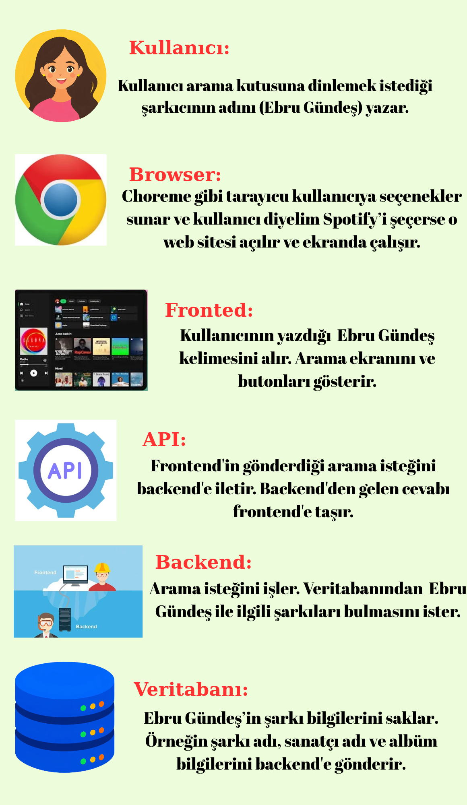
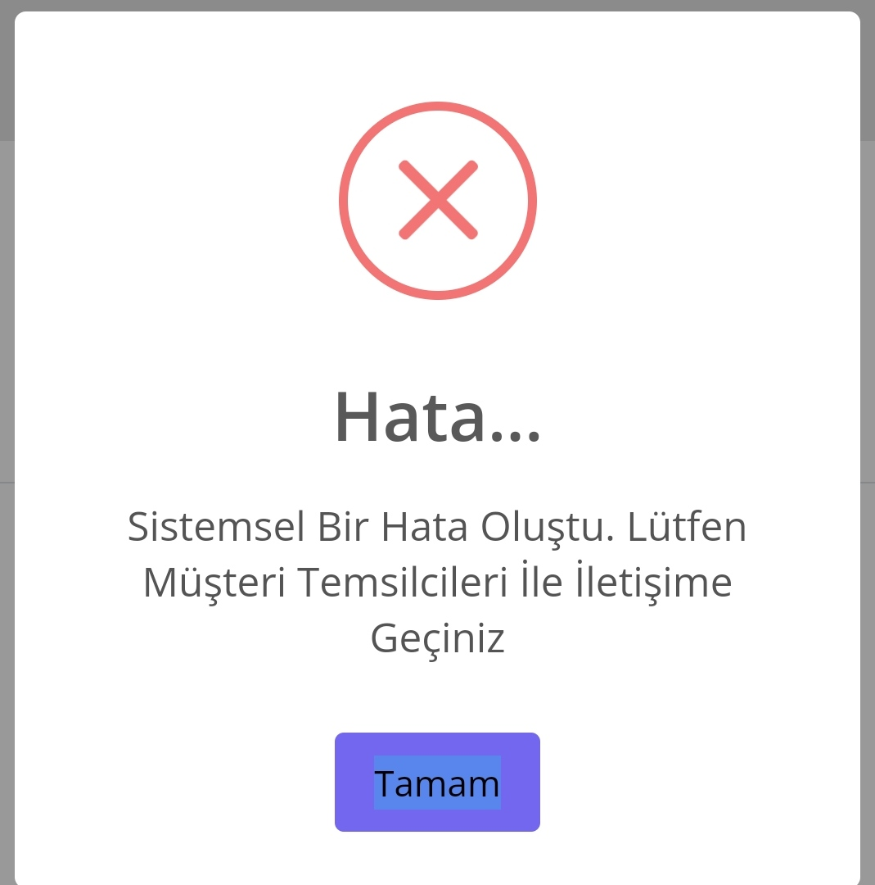
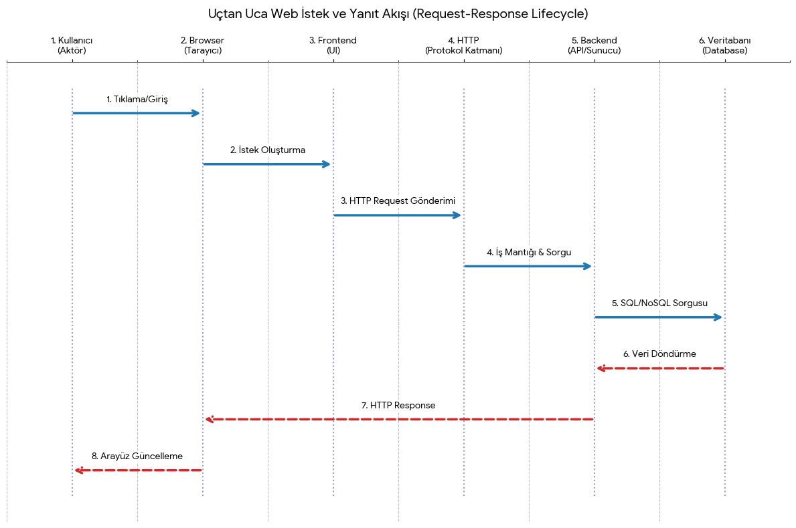

**4. Hafta --Webin Devamı, Güvenlik ve Büyük Resim**

TARİH:21 Ekim Çarşamba

KONU:Bütün parçaları tek bir sistemde birleştirebilir miyiz?

**##Araştırma Soruları**
*1)Kullanıcı, browser, frontend, backend, API, veritabanı ve Git/GitHub kavramları aynı projede nerede durur?*

*2)Bir kullanıcı butona bastığında veri hangi aşamalardan geçebilir?*

*3)Uygulamanın çalışan hâli ile kaynak kodunun GitHub’daki hâli aynı şey midir?*

*4)Hata çıktığında problemi frontend, backend, network veya veritabanı tarafında nasıl ayırmaya başlayabilirsiniz?*

*5)Bu dört haftada öğrendiğiniz kavramlardan hangileri birbirine bağlı çıktı?*

**##Günün Soununda Teslim Edilecek Notlar**

*1)Final notu hazırlayın: basit bir web uygulamasını kod yazmadan baştan sona tasarlayın.*

*2)Kullanıcı -> browser -> frontend -> HTTP -> backend -> veritabanı -> response akışını kendi çiziminizle gösterin.*

*3)Bu dört haftanın başında yanlış bildiğiniz veya hiç bilmediğiniz en az beş şeyi yazın.*

*4)Hâlâ kafanızda oturmayan en az üç soruyu açıkça yazın.*

**##Ek Görev**

- Günün sonunda notlarınızı kullanarak kısa bir anlatım yapacaksınız. Ezber beklemiyorum; kendi kurduğunuz bağlantıları görmek istiyorum.

--------------------

***1.SORU:Kullanıcı, browser, frontend, backend, API, veritabanı ve Git/GitHub kavramları aynı projede nerede durur?***

**Kullanıcı:** *Kullanıcı uygulamayı kullanan kişi.*

**Browser:** *Web tarayıcısı demektir.İnternet sitesine giriş yapmak ve buralardwan içerik görüntülemek için browser gibi yazılımlar kullanılır*

**Frontend:** *Bir uygulamanın yada web sitesinin kullanıcının gördüğü yüzüdür.Görseller ve içerikler burada bulunur.*

**Backend:** *Bir uygulamanın veya web sitesinin kullanıcının görmediği yüzüdür.*

**API:** *Yazılım geliştirme arayüzüdür.Yazılım sistemlerinin birbiriyle iletişim kurmasını sağlayan bir dizi kural ve tanımıdır.*

**Veritabanı:** *Elektronik olarak depolanan,sistematik bir veri koleksiyonudur.*

**Git/GitHub:** *Git bir versiyon kontrol sistemidir.Github ise git ile takip ettiğimiz dosyaların bulutta depolanmasını ve paylaşılmasını sağlayan platformdur.*

>Hepsi birlikte nasıl çalışır?

--------
**2.SORU: Bir kullanıcı butona bastığında veri hangi aşamalardan geçebilir?***

*Kullanıcı butona bastığında fronted bu işlemi algılar ve verileri API ile backend e iletir.Backend verileri kontrol eder
gerektiğinde veritabanı ile iletişim kurar.İşlem bittikten sonra backende bir cevap yollar.Fronted buı yanıtı kullanıcı ekranında gösterir.*

------------------

**3.SORU:Uygulamanın çalışan hali ile kaynak kodunun GitHub'daki hali aynı şey midir?**

*Hayır aynı şey değildir ama birbirleri ile bağlantısı vardır.Uygulamaın çalışan hali kullanıcının kullandığı uygulamadır,Menüler,butonlar vb. şeyler bulunur.GitHub kaynak
kodu ise uygulamanın nasıl yapıldığını gösterir.Yazılımcılar tarafından bakılıp düzeltilebilir ,kodlar görünebilir.*

**KISACASI:** *Çalışan uygulamakullanıcının gördüğü kullanılan kısımdır.GitHub'daki hali ise bu uygulamanın nasıl oluştuğunu gösteren kodları ve bildileri barındırır.*

------------------------
**4.SORU:Hata çıktığında problemi fronted,backend,network veya veritabanı tarafından nasıl ayırmaya başlayabilirsiniz?**

*İlk olarak kodun hangi taraftan hata aldığını bulmamız lazım.Önce fronted i kontrol ederiz Arama butonu çalışıyormu diye sonra network'ü kontrol ederiz isteğimiz backende ulaşıyormu diye
Daha sonra backend i kontrol ederiz.İstediğimizi doğru yapıyormu diye.*

-------------------

**5.SORU:Bu dört haftada öğrendiğiniz kavramlardan hangileri birbirine bağlı çıktı?**

*Frontend ve backend birbirleriyle API aracılığıyla iletişim kurarlar.*
*Bir web sitesine girdiğinde frontend ile karşılaşırsın. Frontend, backend ile iletişim kurar. Bu iletişim HTTP üzerinden gerçekleşir*
*HTTP, API, JSON ve veritabanı birbirinden ayrı konular değildir. Bir web uygulamasında birlikte çalışırlar.*
*Authentication ve authorization,Cookie,Session vb. giriş yapanın kim olduğunu ve hangi işlemleri yapabileceğini belirtir.*

------------------------

**Final notu hazırlayın: basit bir web uygulamasını kod yazmadan baştan sona tasarlayın.**

==Projenin amacı:== *Öğrenci ekleme silme not ekleme listeleme ve güncelleme işlemleri yapmak.*

==1. Kullanıcı:== *Öğretmen, sisteme öğrenci bilgilerini girer.*

==2. Browser:== *Web sitesini açar. (Chrome gibi)*

==3. Frontend:== *Öğretmen öğrenci bilgilerini girer ve butona basar.*

==4. Backend:== *Kullanıcıdan gelen bilgileri işler ve kontrol eder*

==5. API:== *Frontend ile backend arasında iletişim sağlar*

==6. Veritabanı:== *Öğrencilerin ad, soyad, numara ve sınıf bilgilerini saklar.*

==7. HTTP Request:== *Kullanıcının gönderdiği bilgileri backend'e iletir.*

==8. HTTP Response:== *İşlem sonucunu kullanıcıya geri gönderir.*

==9. Test:== *Uygulamanın doğru çalışıp çalışmadığını kontrol eder.*

==10. Git:== *Kodda yapılan değişiklikleri takip eder.*

==11. GitHub:== *Projenin kaynak kodlarını saklar ve paylaşılmasını sağlar.*

-------------------

**Kullanıcı -> browser -> frontend -> HTTP -> backend -> veritabanı -> response akışını kendi çiziminizle gösterin.**

-------------------------

**Bu dört haftanın başında yanlış bildiğiniz veya hiç bilmediğiniz en az beş şeyi yazın.**
.gittignore
Branch
Edge case 
Encapsulation ve abstraction
Authentication ve Authorization 

--------------------------

**Hâlâ kafanızda oturmayan en az üç soruyu açıkça yazın.**

hatırlamıyorum

-------------------------

***##Kaynaklar***
1)https://tr.eitca.org/siber-g%C3%BCvenlik/eitc-wasf-web-uygulamalar%C4%B1-g%C3%BCvenlik-temelleri/kimlik-do%C4%9Frulama-eitc%2C-wasf-web-uygulamalar%C4%B1-g%C3%BCvenlik-temelleridir/kimlik-do%C4%9Frulamaya-giri%C5%9F/inceleme-inceleme-kimlik-do%C4%9Frulamaya-giri%C5%9F/%C5%9Fifreleri-d%C3%BCz-metin-olarak-saklaman%C4%B1n-riskleri-nelerdir/
2)https://cheatsheetseries.owasp.org/cheatsheets/Password_Storage_Cheat_Sheet.html
3)https://zerothreat.ai/blog/what-is-input-validation-and-its-importance
4)https://portswigger.net/web-security/sql-injection
5)https://bulutistan.com/blog/xss-cross-site-scripting-nedir/
6)https://www.kaspersky.com.tr/resource-center/definitions/what-is-a-cross-site-scripting-attack
7)https://eclit.com/tr/knowledge-hub/xss-nedir
8)https://aws.amazon.com/tr/what-is/api-key/

-----